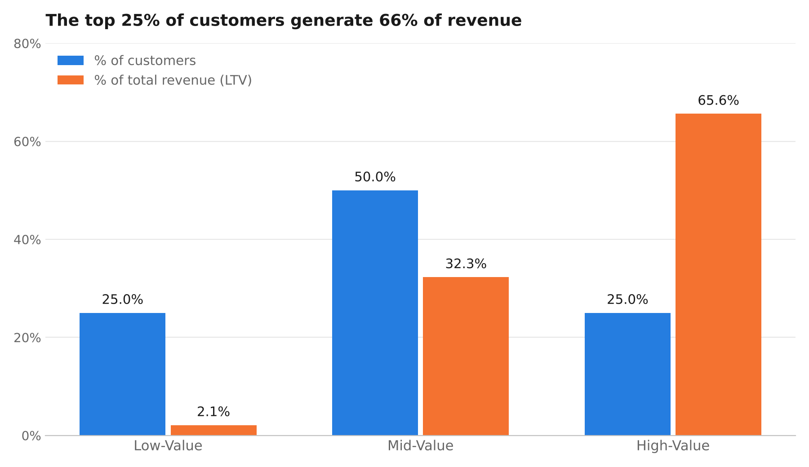
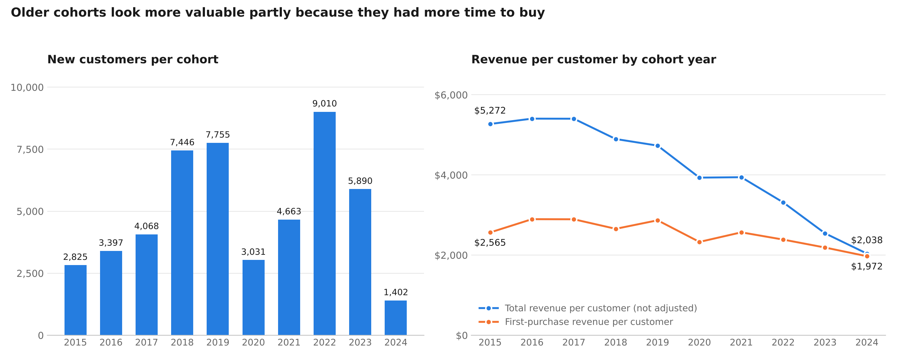
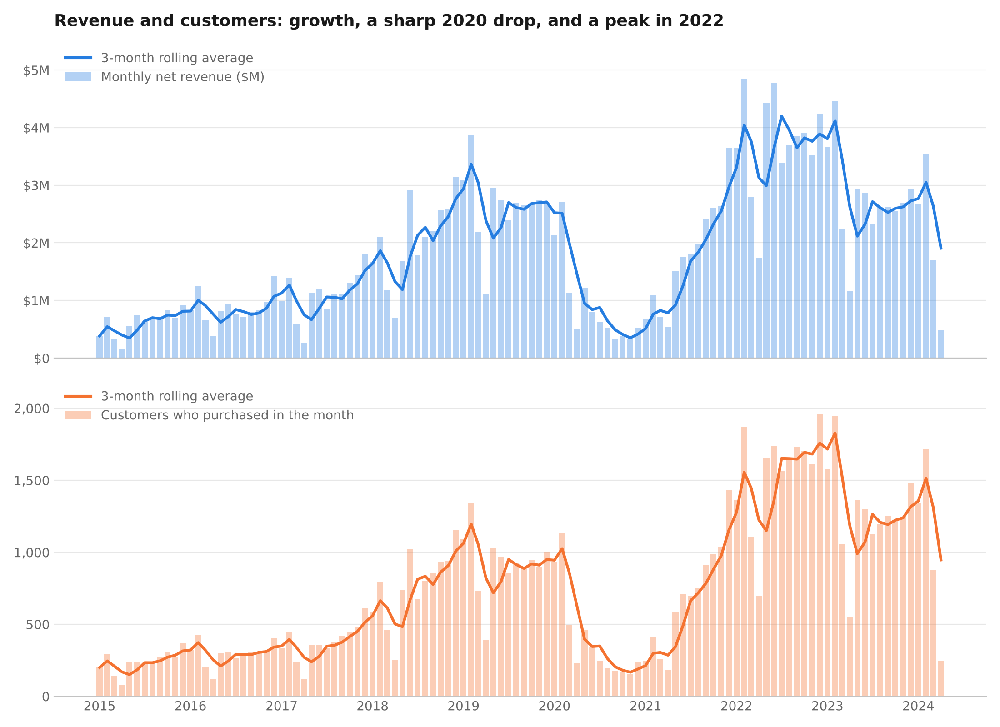
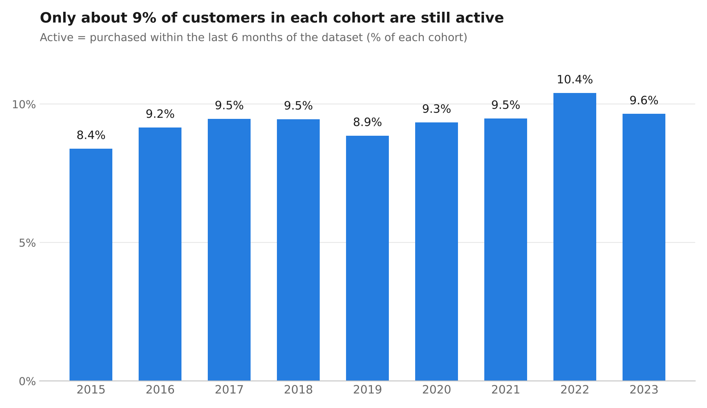

# Contoso 100k: Customer Analytics with SQL

Customer segmentation, cohort analysis and retention analysis on the Contoso 100k retail dataset, written in PostgreSQL.

## Overview

This project answers three business questions about customer value and behaviour using SQL:

1. **Customer segmentation:** how is revenue distributed across low, mid and high value customers?
2. **Cohort analysis:** how much revenue does each year cohort generate, and how do revenue and customers evolve month by month?
3. **Retention analysis:** what share of each cohort has stopped buying?

## Key Findings

- The top 25% of customers generate **65.6%** of total revenue; the bottom 25% generate only **2.1%**.
- A High-Value customer is worth about **31x** a Low-Value one on average ($10,946 vs $351 lifetime value).
- **61.6%** of all revenue happens on the customer's first purchase date, so repeat buying doesn't contribute significantly.
- About **90.5%** of customers have churned and the rate is almost identical across cohorts (90% to 92%).
- Monthly revenue fell **88%** between February and September 2020, recovered through 2021, peaked in 2022 ($44.9M for the year), and settled lower in 2023 ($33.1M).
- **April is the weakest month** in 8 of the 9 full years; December or February is the strongest.

## Tools

- PostgreSQL
- DBeaver for writing and running queries
- Claude for visualization and graphs

## Dataset

Contoso 100k is a sample retail database with six tables. Orders span **January 2015 to April 2024**.

| Table | Description |
|---|---|
| `sales` | Order lines (one row per product in an order): quantity, net price, exchange rate |
| `customer` | Customer attributes: name, age, country, occupation |
| `product` | Product, brand, category and subcategory, cost and price |
| `store` | Store location, size and status |
| `date` | Calendar dimension |
| `currencyexchange` | Daily exchange rates |

The database dump is large, so it is **not included in this repository**. Download it from: `https://github.com/lukebarousse/Int_SQL_Data_Analytics_Course/releases/tag/v.0.0.0`

### Restore the database

```bash
createdb contoso_100k
psql -d contoso_100k -f contoso_100k.sql
```


## The `cohort_analysis` View

[`sql/0_create_cohort_view.sql`](sql/0_create_cohort_view.sql) builds one row per customer per order date with:

- `total_revenue`: `quantity * netprice * exchangerate` (converted to a single currency)
- customer attributes (`full_name`, `countryfull`, `age`)
- `first_purchase`: the customer's first order date
- `cohort_year`: the year of that first purchase

---

## 1. Customer Segmentation

**Question:** how concentrated is revenue across customers?

**Approach:** compute each customer's lifetime value (LTV), find the 25th and 75th percentiles with `PERCENTILE_CONT`, and label customers as Low (below the 25th percentile), Mid (between the 25th and 75th) or High (above the 75th).

**Query:** [`sql/1_customer_segmentation.sql`](sql/1_customer_segmentation.sql)




**Insight:** revenue is heavily concentrated. The 25% of customers in the High-Value segment bring in almost two thirds of the revenue, so protecting and growing this group matters far more than the bottom quarter, which adds about 2% of revenue.

---

## 2. Cohort Analysis

**Question:** how much is a customer worth, depending on the year they were acquired, and how do revenue and customers move over time?

**Approach:** group customers by `cohort_year` and compare four views:

1. Revenue per customer by cohort, **not adjusted** for time in the market.
2. Revenue by **days since first purchase**, with a cumulative percentage of total revenue.
3. Revenue per customer using **only the first purchase date**, so every cohort is compared on the same footing.
4. **Monthly** net revenue and active customers with a 3-month rolling average.

**Query:** [`sql/2_cohort_analysis.sql`](sql/2_cohort_analysis.sql)

### Revenue per customer by cohort




**Insights:**

- Revenue per customer falls from $5,272 (2015 cohort) to $2,038 (2024), but this comparison favours older cohorts because they had more years to buy.
- Using first purchases only, the values sit in a narrower range ($1,972 to $2,896), and the gap between the two lines shrinks as cohorts get newer.
- **61.6%** of total revenue ($127.1M) happens on day 0, the day of the first purchase. The day-1 contribution is only 0.015% of total revenue, and the cumulative share rises very slowly afterwards.
- Cohort sizes are uneven: 2019 and 2022 brought in many more customers (7,755 and 9,010) than 2020 (3,031), which matches the monthly trends below.
- The 2024 cohort only contains customers whose first purchase was between January and April 2024, because that is where the data ends.

### Monthly trends



Full results: [`results/2d_monthly_trends.csv`](results/2d_monthly_trends.csv). 

**Insights:**

- **Growth until 2019:** yearly revenue grew from $7.4M in 2015 to $31.8M in 2019.
- **The 2020 slump:** monthly revenue fell from $2.71M in February 2020 to $0.33M in September 2020 (-88%), and monthly buyers dropped from 1,139 to a low of 156 in November 2020. Revenue was back near $2.6M a month by October 2021.
- **2022 peak:** 2022 was the best year ($44.9M), with the best month in February 2022 ($4.84M) and the most monthly buyers in December 2022 (1,960).
- **A lower plateau afterwards:** 2023 revenue was $33.1M (-26% vs 2022), and from May to December 2023 monthly revenue stayed roughly between $2.3M and $2.9M.
- **Seasonality:** April is the lowest month in 8 of the 9 full years (the exception is 2020), and the highest month is always December or February.
- **Data caveat:** April 2024 shows $0.48M and 246 buyers versus $1.16M and 551 in April 2023, so the last month may be incomplete. Avoid reading the 2024 numbers as a full-year decline.

---

## 3. Retention Analysis

**Question:** what share of each cohort is still buying?

**Approach:** take each customer's most recent purchase (`ROW_NUMBER` over order date, descending). A customer is **Churned** if that purchase is more than 6 months before the latest order date in `sales`, otherwise **Active**. Customers whose first purchase is within the last 6 months are excluded, so recent customers are not wrongly counted as churned.

**Query:** [`sql/3_retention_analysis.sql`](sql/3_retention_analysis.sql)




**Insights:**

- Across cohorts, between 90% and 92% of customers are churned (90.5% overall: 42,472 churned vs 4,441 active).
- Retention barely changes from older to newer cohorts, and the larger cohorts (2019, 2022) retain no better than the small ones. This matches the cohort finding that most revenue comes from the first purchase.

---

## Business Recommendations

1. **Protect and grow the High-Value segment.** 12,372 customers (25%) produce 65.6% of revenue, so a loyalty or VIP program with priority service is worth the investment.
2. **Move Mid-Value customers up.** The Mid-Value customers have an average LTV of $2,693 versus $10,946 for High-Value. As an illustration, every 1,000 customers that reach the High-Value average would add about $8.3M in lifetime value.
3. **Keep spending on Low-Value customers efficient.** They add 2.1% of revenue, automated campaigns make more sense than costly retention offers.
4. **Focus on the second purchase.** With 61.6% of revenue on the first purchase date and about 90% churn, onboarding offers and follow-ups in the first weeks, plus win-back campaigns for lapsed high-value customers, have the most room to improve results.
5. **Plan around seasonality.** Demand peaks in December and February and is weakest in April, so promotions and re-engagement campaigns fit best in the slow months.
6. **Loyalty programs** to stabilize revenue fluctuations 

## SQL Techniques Used

- Common Table Expressions (CTEs)
- Window functions: `ROW_NUMBER()`, `MIN() OVER`, running `SUM() OVER`, rolling `AVG() OVER` with a window frame
- `PERCENTILE_CONT` for percentile-based segmentation
- `CASE` expressions for segment and churn labels
- Views to reuse the cohort logic across queries
- Date functions: `DATE_TRUNC`, `INTERVAL` arithmetic


## How to Reproduce

1. Restore the Contoso 100k database (see above).
2. Run `sql/0_create_cohort_view.sql`.
3. Run the scripts in any order and compare with the results shown here.
4. To redraw the charts: `python charts/make_charts.py` (requires matplotlib).

## Credits

This project is based on the Intermediate SQL project from Luke Barousse's course ([course repository](https://github.com/lukebarousse/Int_SQL_Data_Analytics_Course)) and follows the [tutorial video](https://www.youtube.com/watch?v=QKIGsShyEsQ). The results and charts shown here come from my own run of the queries.

